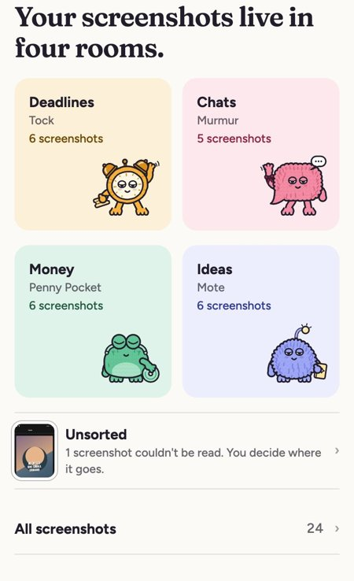
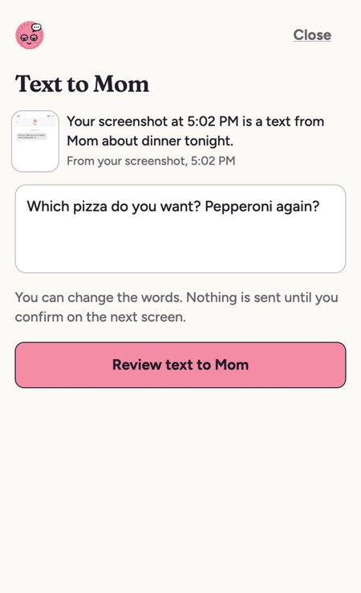
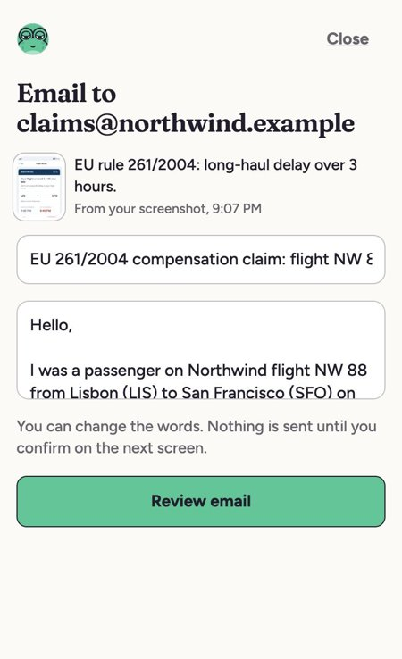

<p align="center">
  
</p>

<h1 align="center">shots.</h1>

<p align="center">
  <b>You screenshot things so you'll remember them. Shots actually remembers.</b><br>
  An iPhone app that reads your screenshots, files each one into a room, answers questions with the source screenshot attached, and drafts the reply or calendar event for you to confirm. All of that runs today.
</p>

<p align="center">
  Built in one day by three people at the YC Consumer Mobile Hackathon · Nov 15, 2026<br>
  <a href="https://www.youtube.com/watch?v=W6rpVYRAjoI"><b>▶ Watch the film (49s)</b></a>
</p>

<p align="center">
  
  
  
  
  
  
</p>

<p align="center">
  <a href="https://www.youtube.com/watch?v=W6rpVYRAjoI"></a>
</p>

---

## Why we built this

Everyone has a camera roll full of screenshots taken "for later": the date a sign-up closes, a text from Mom you still owe a reply, a flight alert, a receipt. The screenshot does its job of capturing the thing. Then it sinks under thousands of others, and later never comes.

Nothing does the second job: **remembering it for you**, and bringing it back at the moment it matters.

We didn't want to build another inbox to clear. We wanted something that quietly looks after your screenshots, says *psst* at the right moment, and has the next step already prepared. You stay in charge of every tap.

## What it does

<table>
  <tr>
    <td width="33%" align="center"><br><b>Four rooms, four keepers</b></td>
    <td width="33%" align="center"><br><b>Scripted demo: a reply to Mom, drafted from her text</b></td>
    <td width="33%" align="center"><br><b>Scripted demo: an EU261 claim, drafted from a flight alert</b></td>
  </tr>
</table>

- **Every screenshot gets a home.** Shots reads your Screenshots album and files each one into a room, looked after by a keeper: **Tock** (deadlines), **Murmur** (chats), **Penny Pocket** (money) and **Mote** (ideas).
- **Today's handful.** The home screen shows at most three things that matter right now, each with one action, like *"Tock filed a sign-up that closes Friday: Remind me Thu 9:00 AM."*
- **Ask, with proof.** *"When does pottery sign-up close?"* gets a one-line answer with the source screenshot right under it, so you can check it yourself. It works from Siri too.
- **Keepers get it ready, you confirm.** A reply opens in Messages or Mail already written, and an event drops into Calendar. Nothing goes out until you tap.
- **Glimpses of where this goes.** Two scripted end-to-end proofs of concept: Murmur turns Mom's *"Pizza tonight?"* into a drafted reply plus an order ready to place, and Tock spots a Lisbon → SFO flight that landed 6 hours late, then hands it to Penny Pocket, who drafts the EU261 claim for €600. In the demo nothing is really ordered, charged or filed.
- **Privacy, said plainly.** Shots reads only your Screenshots album. Screenshots go to our server and an AI model to be read. We don't sell data, and you can delete everything from Settings.

## How it's built

| Layer | What we used |
|---|---|
| **App** | Expo SDK 58, React Native 0.88, Expo Router (Today, Rooms, Ask). `expo-media-library` for the Screenshots album, Reanimated and haptics for the keepers' motion, `@expo/ui` and `expo-glass-effect` for native iOS controls |
| **Reading** | Screenshots go to Convex file storage. An action sends each one to an OpenAI vision model and stores a title, summary, text, dates and a room |
| **Memory and Ask** | Every reading goes into a per-user Supermemory namespace. Ask searches it, and a model writes a one-line answer that cites the screenshot |
| **Acting** | A small *act* framework (`src/lib/act/`) turns a reading into a prepared card (why, the source, exactly what will go out) that ends on one confirm tap. Real effects use `expo-sms`, `expo-mail-composer` and `expo-calendar` |
| **Reminders** | The Convex scheduler, one reminder per item, with snooze and off switches |
| **Proof** | Revyl builds the iOS app on a cloud iPhone for pull requests and runs a proof-of-changes check |

### How three people shipped this in a day

Three of us designed and built Shots. We wrote the product rules, then ran AI agents in parallel on [Capy](https://capy.ai) to produce drafts, which we accepted, rejected or rewrote.

- **What we decided ourselves:** at most three things a day, the five privacy claims and the banned phrases, auto-read on by default but disclosed, nothing sends or spends without a tap, and the rename an hour before the deadline. We tested on our own phones all day.
- **Design:** an agent design lead ran about a dozen design lanes: keeper art, copy and voice, motion, native iOS spec, accessibility and dark mode, system surfaces, onboarding, personas and brand. A **critic** agent scored every screen, and a **product psychologist** agent audited every flow for trust, friction and honesty.
- **Build:** an agent build lead ran a ticket board of subagent engineers, one branch and one PR each, with AI review on every push and a cloud-iPhone proof on every PR.

**In one day:** a working iPhone app, an original cast of four characters, and 474 passing tests. Behind it: 108 merged PRs with cloud-iPhone build checks, ~20k lines of TypeScript, and about 275 screen mockups and states that we reviewed.

## What was hard

- **Earning trust before being clever.** An app that reads your screenshots has to be honest about it. Early on we wrote a privacy ruling: five plain claims we can stand behind, plus banned phrases like *"never leaves your phone."* The critic flagged 44 of 275 screens against it, and every one was rewritten.
- **Auto-read vs. consent.** The magic moment ("it's already filed") only works if reading is automatic, and that's only okay if people know. It's on by default and disclosed once, right beside the button that starts it. Anything read automatically shows up as *Just in*, with a way to forget it.
- **Acting without overreaching.** Drafting a reply or an order is easy. Making sure it never sends or spends without you is the real design work: every action ends on one tap that shows exactly what goes out.
- **iOS builds in the cloud.** A native module mismatch broke our cloud iOS build for most of the afternoon. We bisected it and removed `expo-dev-client` to fix it.
- **One voice, four characters.** The keepers can be charming when they show you something, but never inside an answer. Answers stay plain: one line plus the source.

## What we learned

The best decision we made was a limit, not a feature. Capping the home screen at **three things a day** forced every other choice: what counts as worth showing, when to stay quiet, and why every answer carries its source. We haven't tested it on real users yet. That's next.

## Where it goes next

- **Keepers that keep watch all day.** Shots running in the background with real agency: catching the flight delay as it happens, preparing the claim, lining up the order. You confirm with one tap on anything that sends or spends.
- **Real merchant and airline integrations** behind that confirm tap, replacing today's scripted demos.
- **Widgets, Lock Screen and Live Activities** that show what's due without revealing amounts or chat content.

## Team

**[Ryan Ding](https://github.com/RyanFDing)** · **[Derek Sun](https://github.com/sunnidunni)** · **[Brad](https://github.com/brad945)**

Started as *Rooms*, then *Psst*, and renamed **Shots** an hour before the deadline. You'll still see *Psst* in parts of the code.

---

## Build it yourself


### Install on your iPhone from your Mac (free Apple ID, no paid account)
You need Xcode from the App Store, opened once, with your Apple ID added in Xcode → Settings → Accounts. You also need Node 20 or newer.

1. On the iPhone, turn on Settings → Privacy & Security → Developer Mode and restart it. Connect it to the Mac by cable and tap **Trust**.
2. Get the code and install dependencies:
   ```sh
   git clone https://github.com/sunnidunni/cmhackathon && cd cmhackathon
   git checkout capy/phase1-foundation
   npm ci
   ```
3. Build and install a standalone Release build, which bundles the JS so no dev server is needed:
   ```sh
   npx expo run:ios --device --configuration Release
   ```
   Pick your iPhone. When asked for a development team, pick your **Personal Team**.
4. On the iPhone, open Settings → General → VPN & Device Management, then trust your Apple ID's developer app. Open **Psst**.

If signing fails in step 3, open `ios/Psst.xcworkspace` in Xcode. Under the Psst target → Signing & Capabilities, set Team to your Personal Team. If Xcode says the bundle identifier is taken, change `ios.bundleIdentifier` in `app.json` to something unique and rerun step 3.

Notes:
- A free-team install expires after 7 days; rerun step 3 to refresh it.
- The app uses local notifications only, so it has no push entitlement and needs no paid account.
- Leave the dev flags unset on a real phone, because it has a real Screenshots album.
- The backend URL comes from `.env`, which is committed.


An iPhone app that pulls in your screenshots, reads them, sorts them into rooms, answers questions about them, and reminds you about the ones that matter. Expo + Convex.

### Developer setup

Expo SDK 58 (React Native 0.88, expo-router) + Convex. App code in `src/`, backend in `convex/`.

#### Layout
- `src/app/`: expo-router screens. `_layout.tsx` (Convex provider + silent anonymous sign-in), `index.tsx` (routes to priming or library by photo permission), `priming.tsx`, `library.tsx`. Add new screens as new files here; one file per screen avoids merge conflicts.
- `src/components/`: shared UI (`state-views.tsx` has LoadingView, MessageView, Button).
- `src/lib/`: client logic. `convex.ts` (client), `photos.ts` (permission, Screenshots query, resize), `import-one.ts` (upload one screenshot), `dev-flags.ts`, `secure-storage.ts`.
- `convex/`: `schema.ts` (all tables from spec section 5 + indexes), `auth.ts`, `screenshots.ts`, `users.ts`, `lib/auth.ts` (`requireUserId`: the ONE helper every function uses to get the current user), tests in `*.test.ts`.

#### Auth
Convex Auth **v1** (`@convex-dev/auth@0.0.98`) with the `Anonymous` provider. v2 (the npm `latest`) has no anonymous method and no React Native guide, so do not upgrade. On first launch `_layout.tsx` calls `signIn("anonymous")`; the session lives in the keychain via expo-secure-store, so relaunches keep the same user. Every row stores `userId`; always get it through `requireUserId(ctx)`. A later real sign-up should add a provider and account linking so the anonymous `users` row is kept (see labs.convex.dev/auth/config/anonymous).
Deployment env vars already set: `JWT_PRIVATE_KEY`, `JWKS`, `SITE_URL`. Do not regenerate them (it logs everyone out).

#### Convex
- `CONVEX_DEPLOY_KEY` is in the machine env and points at the dev deployment `frugal-grasshopper-744`.
- Deploy: `npx convex deploy -y` (typechecks, regenerates `convex/_generated`, pushes). Commit `convex/_generated`.
- Env: `npx convex env list|set NAME -- value`. Server keys (OpenAI, Supermemory, Whop) go here, never in app code.
- Tests: `npm test` (vitest + convex-test). Typecheck: `npm run typecheck`.
- Every thread deploys to the same dev deployment. Deploy only additive schema changes, and deploy after merging main, or you will push an older schema/functions over someone else's.
- The app reads the public URL from `.env` (`EXPO_PUBLIC_CONVEX_URL`, not secret, committed).

#### Build for a Revyl cloud iPhone (simulator, no signing)
Cloud machines have no Xcode. Use `tools.mobile.build`:
```
tools.mobile.build({ action: "start", platform: "ios", app: "cmhackathon", source: { type: "workspace", path: "cmhackathon", commands: [
  "npm ci",
  "npx expo prebuild --platform ios --clean",
  "set -o pipefail && EXPO_PUBLIC_CONVEX_URL=https://frugal-grasshopper-744.convex.cloud EXPO_PUBLIC_DEV_TOOLS=1 EXPO_PUBLIC_READ_ALL_PHOTOS=1 xcodebuild -workspace ios/Psst.xcworkspace -scheme Psst -configuration Release -sdk iphonesimulator -destination 'generic/platform=iOS Simulator' -derivedDataPath ios/build CODE_SIGN_IDENTITY=- | tail -200"
], output_path: "ios/build/Build/Products/Release-iphonesimulator/Psst.app" } })
```
- `CODE_SIGN_IDENTITY=-` ad-hoc signs the simulator app. Do not use `CODE_SIGNING_ALLOWED=NO`: an unsigned app has no keychain entitlement, expo-secure-store fails, and anonymous sign-in hangs.
- Set `EXPO_PUBLIC_CONVEX_URL` on the xcodebuild line too if you want it explicit; otherwise it comes from `.env`.
- Release config embeds the JS bundle, so the phone needs no Metro server. Every JS change needs a rebuild (about 15 min cold, faster once Xcode's cache is warm).
- `EXPO_PUBLIC_*` vars are inlined at bundle time; set them on the xcodebuild line.
- Then `tools.capy.phone({ action: "attach", platform: "ios", model: "iPhone 16" })` once, and `tools.capy.phone({ action: "install", machine, build_id })`. Sessions end after 60 min and app data is lost (new anonymous user, permission prompt again).

#### Seed a photo on the simulator
`tools.capy.phone({ action: "open_url", url: "https://picsum.photos/id/237/1080/1920.jpg" })`, long-press the image (mouseDown, wait 1.5 s, mouseUp), tap "Save to Photos". The simulator also ships with a few sample photos.
Saved images are NOT screenshots: they lack the screenshot subtype, so the default (Screenshots-only) import finds nothing on a simulator. Build with `EXPO_PUBLIC_DEV_TOOLS=1` and flip "Dev: read all photos" on the library screen, or build with `EXPO_PUBLIC_READ_ALL_PHOTOS=1` to default it on. On the Revyl iPhone 16 (iOS 26) the Screenshots smart album exists but holds 0 items; the library has 6 sample photos, none with the screenshot subtype. With the flag off the app says "No screenshots found yet."; with it on, the newest photo uploads.

#### Dev flags (`src/lib/dev-flags.ts`)
- `EXPO_PUBLIC_DEV_TOOLS=1`: shows the dev panel (read-all-photos switch, library diagnostics: smart albums, Screenshots album count, screenshot-subtype count, all-images count).
- `EXPO_PUBLIC_READ_ALL_PHOTOS=1`: import reads all photos by default.
Leave both unset for the demo build on the real iPhone.

#### Run on a real iPhone (free personal team, needs a Mac with Xcode)
1. `npm ci`
2. `npx expo run:ios --device` and pick the phone (connected by cable, Developer Mode on).
3. If signing fails, open `ios/Psst.xcworkspace` in Xcode, Signing & Capabilities, Team: your Personal Team. Bundle id is `com.sunnidunni.cmhackathon.rooms`; change it in `app.json` if Apple says it is taken.
4. On the phone: Settings, General, VPN & Device Management, trust the developer.
The app has no push-notification entitlement, so free signing works. Do not add remote push (expo-notifications remote) without a paid account; local notifications are fine.
